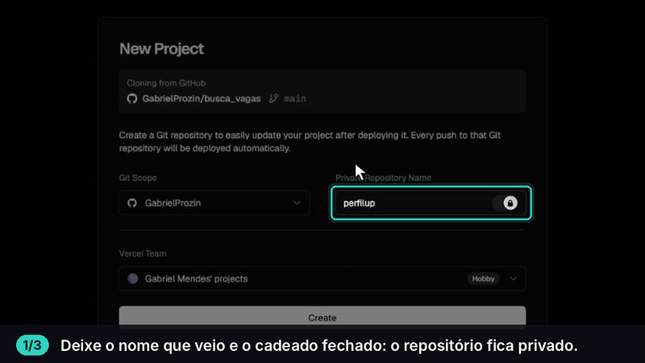
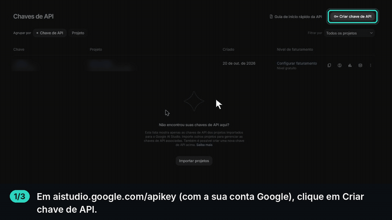
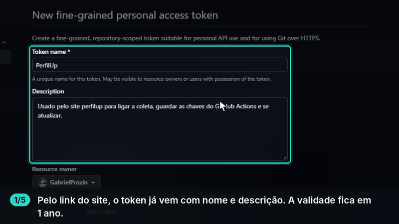

# busca_vagas

Radar pessoal de vagas. Todo dia ele busca vagas em várias fontes, descarta o que não combina com você
(área, nível, local), dá uma **nota explicável** contra o **seu currículo** e ajuda a se candidatar:
escreve o email para o recrutador, manda pelo **seu Gmail** com o currículo anexado e acompanha cada
candidatura até o fim, com lembrete de follow-up.

Tudo roda em planos grátis, e cada pessoa tem a **própria cópia**: o seu banco, o seu site, os seus dados.

- **Vagas**: lista ordenada pela nota, com o porquê da nota, busca e filtros (com email, remoto, cargo).
- **Vaga**: resumo feito pela IA, email ao recrutador pronto para revisar e enviar, situação e anotações.
- **Candidaturas**: quadro (kanban) de arrastar, com aviso quando passa da hora do follow-up.
- **Envio em lote**: escolha várias vagas com email de uma vez, confira os emails prontos e coloque na fila; o
  GitHub envia em segundo plano, no horário e com pausa entre um e outro, até o limite do dia.
- **Respostas lidas do Gmail**: quando o recrutador responde, a candidatura vai sozinha para "Respondeu" (e o
  follow-up para); email que voltou (endereço não existe) fica marcado.
- **Email de resumo**: duas vezes por dia, as vagas novas com nota alta e os follow-ups do dia.
- **Posts do LinkedIn com email do recrutador**: busca automática (sem usar a sua conta) e uma extensão do
  Chrome que manda os posts que você está vendo.
- **Tipos de vaga**: as vagas abertas agrupadas por semelhança do texto (embeddings e k-means), num ranking do tipo
  que mais combina com você para o que menos, com quantas vagas há, o que você já tem e o que falta em cada tipo.
- **O que estudar**: as habilidades que as vagas pedem e não estão no seu currículo, com quantas vagas cada uma
  destravaria (as em que é a única coisa que falta) e os seus pontos fortes no mercado.
- **Perfil profissional**: o seu nível de mercado (estágio, júnior, pleno, sênior) com o motivo, o próximo passo
  mais útil e a evolução das notas.
- **Análise de CV**: nota de 0 a 100 do currículo em 4 critérios explicados (habilidades que o mercado pede,
  resultados com números, estrutura e clareza da escrita), com histórico e variação. Para uma vaga, mostra a conexão,
  o que destacar, as lacunas e responde às perguntas do formulário só com fatos do seu currículo.
- **Preferências da busca**: remoto, híbrido e presencial, cidades (busca entre todas as do Brasil), cargos, nível,
  anos de experiência, CLT ou PJ, palavras e empresas a evitar e vagas em inglês, tudo ajustado no site; serve para
  qualquer área, não só dados.
- **Instalação guiada e atualizações**: um botão cria tudo, o site guia o resto e avisa quando há versão nova,
  que se instala com um clique sem apagar o que é seu.
- **Uso dos serviços**: quanto de cada plano grátis já foi usado (GitHub, Supabase, Apify, Gemini, Gmail), com
  aviso por email ao passar de 80%.
- **Ranking que aprende**: vagas parecidas com as que você aplica sobem; com as que descarta, descem.

> Como o sistema funciona por dentro, com as regras: [`docs/spec.md`](docs/spec.md).

---

## Como instalar (uns 15 minutos)

Você precisa de uma conta no [GitHub](https://github.com/signup) e outra na [Vercel](https://vercel.com/signup)
(entre na Vercel com o GitHub). As duas são grátis e nenhuma pede cartão.

1. **Clique no botão:**

   [](https://vercel.com/new/clone?repository-url=https%3A%2F%2Fgithub.com%2FGabrielProzin%2Fbusca_vagas&root-directory=site&project-name=perfilup&repository-name=perfilup&env=SITE_PASSWORD&envDescription=A%20senha%20para%20entrar%20no%20seu%20site%20%2812%20caracteres%20ou%20mais%29&envLink=https%3A%2F%2Fgithub.com%2FGabrielProzin%2Fbusca_vagas%23como-instalar-uns-15-minutos&stores=%5B%7B%22type%22%3A%22integration%22%2C%22integrationSlug%22%3A%22supabase%22%2C%22productSlug%22%3A%22supabase%22%2C%22protocol%22%3A%22storage%22%7D%5D)

2. Na Vercel, ligue a sua conta do GitHub e deixe o repositório **privado** (o seu currículo vai ficar nele).
   Clique em **Create**.

   

3. Em **Supabase**, aceite criar o banco: região **São Paulo** (a mais perto do Brasil) e plano **Free**. A Vercel cria o banco e liga ao site sozinha.
4. Em **SITE_PASSWORD**, escolha a senha do seu site (12 caracteres ou mais) e clique em **Deploy**. Leva uns 2 minutos.
5. Abra o endereço que a Vercel mostrar, entre com a senha e siga a tela **Instalação**. São 7 passos, e cada um
   tem o link de onde pegar o que pede e testa antes de salvar:
   1. **Banco de dados**: as tabelas já vêm criadas.
   2. **Chave do Gemini** (a IA que lê o currículo e escreve os emails; grátis).
   3. **Gmail e senha de app**, para enviar as candidaturas do seu email.
   4. **Token do GitHub**: o link já vem com tudo marcado, você só escolhe o repositório. Com ele, o site liga a
      coleta automática e guarda o seu perfil no repositório.
   5. **Seu perfil**: envie o currículo em PDF; a IA monta habilidades, pontos fortes e o texto, e você confere.
   6. **Preferências da busca**: onde trabalhar, cidades, cargos, nível, contrato e o que evitar, numa tela só.
   7. **Primeira coleta**: um clique, e em uns 10 minutos as vagas aparecem.

**Como criar a chave do Gemini** (passo 2):



**Como criar o token do GitHub** (passo 4):



Dentro do site, esses passos também têm um botão **Ver como fazer**. As chaves ficam cifradas no seu banco, e
ninguém além de você as vê.

### Travou em algum passo?

Abra a IA que você usa (Claude, ChatGPT, Gemini…), cole o texto abaixo e siga com ela.

```text
Estou instalando a minha cópia do PerfilUp (busca_vagas), um radar pessoal de vagas que roda
grátis em GitHub + Supabase + Vercel: https://github.com/GabrielProzin/busca_vagas
O README ("Como instalar") e o docs/spec.md do repositório explicam tudo.

A instalação é: o botão "Instalar na Vercel" do README e, depois, a tela "Instalação" dentro do
próprio site, que guia 7 passos (banco, chave do Gemini, Gmail e senha de app, token do GitHub,
currículo em PDF, preferências e primeira coleta). O que eu procuro (cidades, cargos, nível,
contrato) eu mesmo marco na tela "Preferências da busca"; não precisa me perguntar nem editar
arquivo nenhum.

Me ajude só onde eu travar. Diga exatamente onde clicar, um passo por vez, e espere eu confirmar.
Se der erro, peça a mensagem inteira (ou um print) e descubra a causa antes de sugerir a correção.

Regras: nunca me peça para colar senhas, chaves ou tokens na conversa; eu colo direto no site.
Prefira o plano grátis de tudo e me avise antes de qualquer coisa que possa cobrar.
```

---

## Quanto custa

Nada, se você ficar nos planos grátis. Nenhum serviço abaixo pede cartão para o que usamos.

| Serviço | Para quê | Plano grátis |
|---|---|---|
| GitHub | Código, a coleta (5x por dia) e o envio da fila | Repositório privado: 2.000 min/mês de Actions (veja abaixo). Público: ilimitado |
| Supabase | Banco de dados e o PDF do currículo | 500 MB; pausa se ficar 7 dias sem uso (a coleta evita isso) |
| Vercel | O site | Hobby |
| Google AI Studio (Gemini) | Escrever emails e resumir vagas | Cota diária grátis; acabou, o site usa um modelo pronto |
| Gmail | Enviar os emails | Senha de app |
| Apify (opcional) | Posts do LinkedIn com email | US$ 5/mês de crédito grátis, sem cartão |

A página **Uso dos serviços** do site mostra o consumo de cada um contra o limite grátis e manda um email se algum
passar de 80%. A Vercel não dá para medir sem dar ao site um token da sua conta; para uma pessoa, o plano Hobby sobra.

**Minutos do GitHub num repositório privado (estimativa):** coletas e rodadas de envio usam uns 1.300 min/mês. Cada
email enviado pela fila soma ~1,5 min, porque a pausa entre emails conta como tempo de Actions: uns 15 emails por dia
pela fila cabem no plano grátis. Para mais, diminua `envio.intervalo_segundos` ou `envio.limite_diario` em
`config/preferencias.yaml`. Se passar, o GitHub só para os workflows até o mês virar (não cobra sem cartão cadastrado).

---

## Receber atualizações

Quando o PerfilUp ganha melhorias, o site avisa em **Configurações → Atualizações**. Clique em **Atualizar agora**:
em uns 3 minutos o site novo está no ar, e tabelas novas do banco são criadas sozinhas.

- **Nunca são tocados:** a pasta `perfil/` (perfil e currículo) e o que você salvou no site (preferências, chaves,
  candidaturas).
- **Se você mudou o código:** a atualização funciona como um merge. Pega só o que mudou no PerfilUp desde a sua versão
  e aplica por cima das suas mudanças. Se você e a versão nova mexeram no mesmo trecho, nada muda no site no ar: abre
  um Pull Request no seu repositório (**Atualização do PerfilUp: precisa de revisão**) com os arquivos em conflito,
  para você escolher o que fica.

Para quase nunca ter conflito:

1. Mude gostos pelas telas (**Preferências da busca**) ou em `perfil/`, e não no código.
2. Para mudar o código, prefira arquivos novos a reescrever os que já existem.
3. Se a sua melhoria serve para todo mundo, mande um Pull Request para o
   [repositório original](https://github.com/GabrielProzin/busca_vagas). Quando ela entra, o conflito some na
   próxima atualização.

**Cópias feitas antes de 29/10/2026** não têm o botão. Para ganhar, uma vez só:

1. No seu repositório, **Add file → Create new file**, com o nome `.github/workflows/atualizar.yml`, e cole o
   conteúdo de [`atualizar.yml`](.github/workflows/atualizar.yml). Faça o mesmo com
   [`scripts/atualizar.sh`](scripts/atualizar.sh).
2. Crie um token como o da [instalação](#como-instalar-uns-15-minutos) (só o seu repositório, com **Actions**,
   **Contents**, **Pull requests**, **Secrets** e **Workflows** em *Read and write*) e cadastre como secret
   `PERFILUP_TOKEN` (Settings → Secrets and variables → Actions).
3. **Actions → Atualizar o PerfilUp → Run workflow.** Depois disso, o assistente e o botão aparecem no site.

---

## A extensão do Chrome

### Por que ela existe

**O problema.** A maior vantagem deste sistema é mandar o currículo **direto para o email de quem está contratando**,
em vez de cair na mesma fila de centenas de candidatos de um formulário. Só que:

- As plataformas de vagas (Gupy, Sólides, Remotar…) quase nunca mostram email: a candidatura é pelo formulário delas.
- Os emails de recrutador aparecem quase só em **posts do LinkedIn** ("estamos contratando… envie o CV para
  fulana@empresa.com").
- O LinkedIn não tem uma forma oficial de buscar posts, e automatizar a sua própria conta (um robô logado rolando o
  feed) é proibido pelas regras dele e pode **restringir ou bloquear a sua conta**. Não fazemos isso.
- Os buscadores (Google etc.) quase não mostram esses posts, e a busca automática que usamos (um serviço que lê
  posts públicos sem login, pelo Apify) tem cota no plano grátis: rende algumas vagas com email por dia, não todas.
  Numa medição real, só cerca de 1 em cada 10 posts de vaga tinha email.

**Como a extensão resolve (em parte).** Ela usa o que você **já está vendo**, do jeito que qualquer pessoa vê: você
abre uma busca de posts no LinkedIn, rola a página e clica no ícone. A extensão lê os posts que estão na tela, separa
os que têm email e cara de vaga (deixa de fora quem está procurando emprego) e manda para o seu site, onde a IA tira
cargo, empresa e local, dá a nota e guarda só o que combina com você, já com o email do recrutador pronto para usar.
Ela não navega, não rola, não clica e não faz nenhum acesso extra ao LinkedIn.

**Por que "em parte".**

- Não é automática: depende de você abrir a busca e rolar (uns 2 minutos por dia rendem bem).
- Só pega o que carregou na tela. Posts muito longos podem chegar cortados no "…ver mais".
- O LinkedIn muda a página de vez em quando; a extensão tem um plano B, mas pode precisar de ajuste.
- Ler a própria tela é bem diferente de um robô, mas as regras do LinkedIn não aprovam nenhum tipo de coleta.
  Use com moderação, como usaria o site normalmente.

Juntas, a busca automática (duas vezes por dia) e a extensão (quando você quiser mais) trazem bem mais vagas com email
do que qualquer uma sozinha, sem nenhum robô usando a sua conta.

### Instalar (uma vez)

1. No seu repositório no GitHub: **Code → Download ZIP** e descompacte. A extensão é a pasta `extensao`.
2. No Chrome, abra `chrome://extensions`, ligue o **Modo do desenvolvedor** (canto superior direito) e clique em
   **Carregar sem compactação**. Escolha a pasta `extensao`.
3. Clique no ícone da extensão (fixe-a na barra pelo ícone de quebra-cabeça). Nas opções, informe o endereço do
   seu site e o token da extensão, que fica no site em **Configurações → Extensão do navegador → Mostrar o token**.
   Salvar.

### Usar

- **Vários posts de uma vez (LinkedIn):** no site, em **Adicionar vaga**, abra uma das buscas prontas de posts
  (últimas 24h). Role a página por alguns segundos para carregar e **clique no ícone da extensão**. Ela manda os posts da
  tela que têm email e cara de vaga; o site lê cada um com a IA e guarda só os do seu perfil (área, nível, local).
  Um aviso mostra quantas vagas entraram. Pode rolar mais e clicar de novo: o que já foi enviado não repete.
- **Um texto de qualquer site:** selecione o texto da vaga, clique com o botão direito e escolha
  **Enviar para o busca_vagas**.

Quando atualizar o repositório com uma versão nova da extensão, baixe o ZIP de novo e clique em **Atualizar** em
`chrome://extensions` (ou remova e carregue a pasta outra vez).

---

## Envio em lote e respostas

Na tela **Envio em lote**, aparecem as vagas novas com email, cada uma com o email pronto (o seu rascunho, se você já
mexeu nele, ou o modelo pronto). Marque as que quer, abra e ajuste o texto se quiser, e clique em **Colocar na fila**.
Quem envia é o GitHub, em segundo plano, com o currículo em anexo e saindo do seu Gmail (fica em Enviados).

Tudo se ajusta na seção `envio` de `config/preferencias.yaml`:

| Opção | Padrão | O que faz |
|---|---|---|
| `limite_diario` | 40 | Máximo de emails por dia, somando o site e a fila |
| `max_por_execucao` | 10 | Máximo por rodada (as rodadas são de hora em hora) |
| `intervalo_segundos` | [60, 120] | Pausa sorteada entre um email e outro |
| `horario` | [7, 21] | Só envia entre 7h e 21h (Brasília) |
| `automatico.ligado` | false | Se `true`, vagas novas da lista principal com email e nota ≥ `automatico.nota_minima` (90) entram na fila sozinhas, com o modelo pronto, sem você revisar. Ligue só se confiar nos filtros |

E em `dominios_email_excluidos`, os domínios que nunca devem receber email seu (por exemplo, a empresa onde você trabalha).

**Respostas:** a cada rodada, o sistema lê só os cabeçalhos dos emails dos últimos 21 dias da sua caixa de entrada
(sem marcar como lido e sem guardar o conteúdo). Se alguém respondeu a um email de candidatura, a candidatura vai para
"Respondeu"; se o Gmail avisou que o endereço não existe, ela fica marcada como devolvida. Hoje e o Painel (taxa de
resposta) mostram isso.

---

## Opcionais

Nada disto é preciso para começar.

- **Posts do LinkedIn com email (busca automática):** crie uma conta grátis no [Apify](https://console.apify.com)
  (US$ 5/mês de crédito, sem cartão), copie o token em **Settings → API & Integrations** e cadastre no seu
  repositório do GitHub como secret `APIFY_TOKEN` (**Settings → Secrets and variables → Actions → New repository
  secret**). Sem ele, a coleta usa só as plataformas de vagas e a extensão.
- **Vigia da coleta:** se o GitHub pular um horário, a Vercel dispara a coleta e avisa você. Na Vercel, em
  **Settings → Environment Variables**, crie `CRON_SECRET` com um texto aleatório longo e faça um novo deploy.
  Para gerar um no PowerShell:
  `$b = New-Object byte[] 32; [Security.Cryptography.RandomNumberGenerator]::Create().GetBytes($b); -join ($b | % { $_.ToString("x2") })`
- **Teste do envio:** no GitHub, **Actions → Envio da fila de emails → Run workflow**, marcando **teste**. Ele manda
  um email para você mesmo, provoca uma devolução e confere se o sistema percebeu as duas. Nenhum recrutador recebe nada.
- **Aviso se o site cair:** no [UptimeRobot](https://uptimerobot.com), cadastre `https://SEU-SITE.vercel.app/api/saude`.
- **Trocar a senha do site:** na Vercel, mude `SITE_PASSWORD` em **Settings → Environment Variables** e faça um novo deploy.

---

## Para quem programa

```
config/preferencias.yaml   o que buscar e filtrar
perfil/                    currículo e perfil (base da nota e dos emails)
coletor/                   Python: fontes, filtros, ranking, aprendizado, resumo, alertas, follow-up, backup,
                           envio da fila (envio.py) e leitura de respostas no Gmail (respostas.py)
site/                      Next.js na Vercel: páginas, Server Functions, API, testes de ponta a ponta (e2e/)
extensao/                  extensão do Chrome (Manifest V3)
supabase/schema.sql        tabelas (RLS ligado, só o servidor acessa)
.github/workflows/         coleta (5x/dia) com backup cifrado; envio da fila (de hora em hora); testes do site
docs/spec.md               a planta do sistema · AGENTS.md: regras para agentes de IA
```

**Chaves por variável de ambiente:** tudo que o assistente guarda também pode ir em variáveis da Vercel e secrets do
GitHub com o mesmo nome (`GEMINI_API_KEY`, `GMAIL_USER`, `GMAIL_APP_PASSWORD`, `GITHUB_DISPATCH_TOKEN`,
`CAPTURA_TOKEN`, `CONTATO_TELEFONE`, `BACKUP_SENHA`; no GitHub também `SUPABASE_URL`, `SUPABASE_SERVICE_ROLE_KEY`,
`SITE_URL`, `RESUMO_PARA` e `PERFILUP_TOKEN`). A variável vale mais que o que foi salvo pelo site.
Sem a integração da Vercel, rode o [`supabase/schema.sql`](supabase/schema.sql) no SQL Editor do Supabase.

**Rodar localmente**

```bash
# coletor
pip install -r requirements.txt && python -m pytest -q
python -m coletor.pipeline --tfidf          # sem Supabase grava só em saida/

# site em modo demonstração (dados fictícios, Gemini falso, Gmail simulado)
cd site && npm install && npm run build && npx playwright test
```

**A nota de compatibilidade:** 45% texto parecido com o currículo (embeddings multilíngues rodando no próprio
Actions) + 40% habilidades + 15% tipo de cargo, +5 para júnior, e um ajuste de −8 a +8 pelo seu histórico de
aplicadas e descartadas. Detalhes em [`docs/spec.md`](docs/spec.md).

**Segurança:** tudo atrás de login (cookie assinado), segredos só nas variáveis, o navegador nunca fala com o
banco, backup cifrado a cada coleta, testes de ponta a ponta a cada mudança. A conta do LinkedIn de ninguém é
automatizada: os posts vêm de um serviço que busca sem login, ou da extensão quando você clica.
